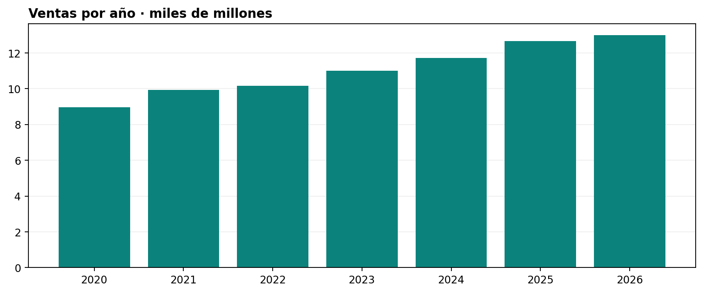
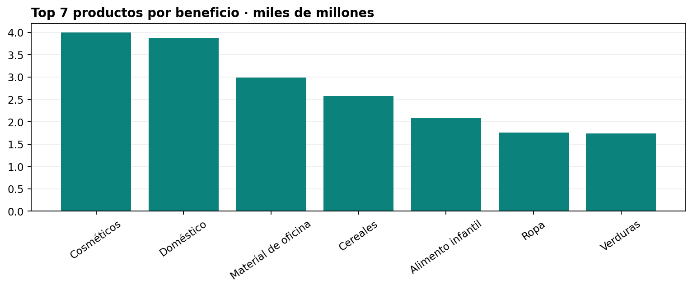
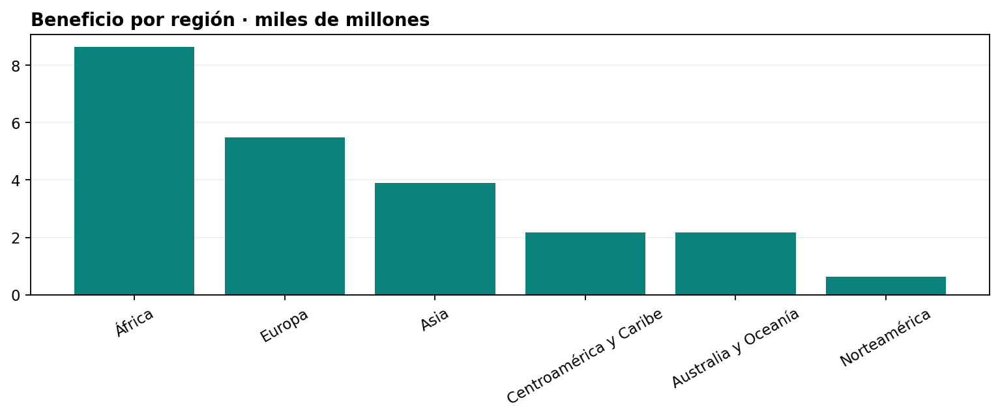

# Proyecto Final: Análisis Exploratorio de Ventas y Dashboard

**Tecnologías:** Python · Pandas · NumPy · Matplotlib · Excel · Estadística

## 1. Objetivo del proyecto

Analizar 60.000 pedidos de una empresa comercial internacional, estudiando la evolución de las ventas, los beneficios, la rentabilidad y la eficiencia de las entregas.

El proyecto incluye limpieza de datos, análisis descriptivo, análisis estadístico, visualización y desarrollo de un dashboard interactivo en Excel.

**Nota:** Los datos son simulados con fines académicos y se analizan como un escenario empresarial. No representan ventas reales verificadas.

## 2. Metodología

- Exploración y auditoría de la calidad de los datos.
- Transformación, normalización y limpieza.
- Análisis descriptivo de las principales variables.
- Aplicación de pruebas estadísticas.
- Visualización e interpretación de los resultados.
- Desarrollo de un dashboard interactivo.
- Elaboración de conclusiones y recomendaciones.

## 3. Visualización de resultados

### Evolución de ventas



### Análisis por productos



### Análisis por regiones



## 4. Dashboard interactivo

El proyecto incluye un dashboard en Excel que permite analizar ventas, beneficios, pedidos y márgenes utilizando filtros por año y región.

**[Descargar Dashboard Excel](Dashboard_Interactivo.xlsx)**

Para utilizar los filtros, abrir el archivo en Microsoft Excel de escritorio.

## 5. Análisis estadístico

Se han aplicado técnicas estadísticas para estudiar las diferencias entre canales comerciales y regiones, además de analizar indicadores de rentabilidad y eficiencia operativa.

Los resultados y su interpretación se desarrollan en el informe.

## 6. Informe final

**[Consultar informe completo en PDF](Informe_EDA_Proyecto_Final.pdf)**

**[Descargar informe editable en Word](Informe_EDA_Proyecto_Final.docx)**

## 7. Reproducción del análisis en Python

Instalar las dependencias:

```bash
python -m pip install -r requirements.txt
```

Ejecutar los programas en este orden:

```bash
python analisis.py
python crear_dashboard.py
python crear_informe.py
```

## 8. Conclusiones

El proyecto permite identificar patrones de ventas, comparar la rentabilidad de productos, canales y regiones, y evaluar la eficiencia de las entregas.

El dashboard facilita la exploración de los resultados para apoyar la toma de decisiones en el escenario analizado.

## 9. Tecnologías utilizadas

- Python para procesamiento y análisis.
- Pandas y NumPy para manipulación de datos.
- SciPy para análisis estadístico.
- Matplotlib para visualizaciones.
- Excel para el dashboard interactivo.

---

**Proyecto final de Análisis Exploratorio de Datos (EDA) y Dashboard.**
